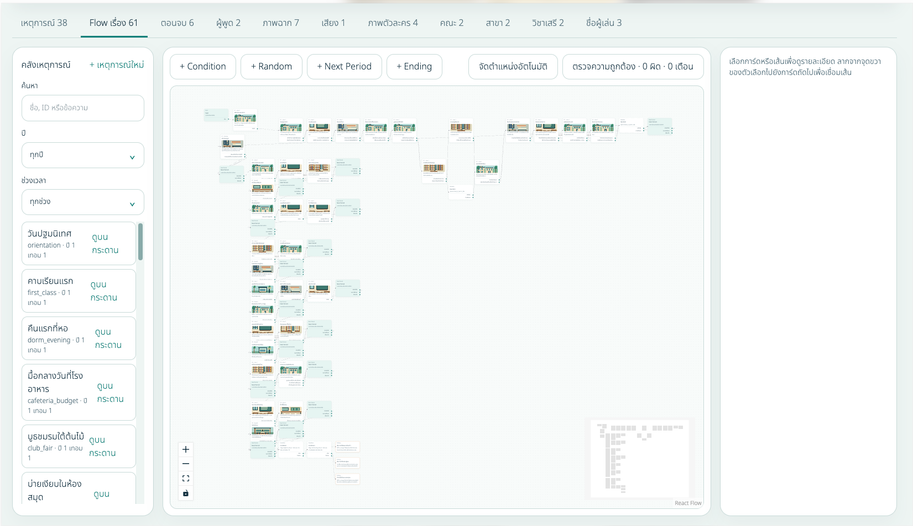
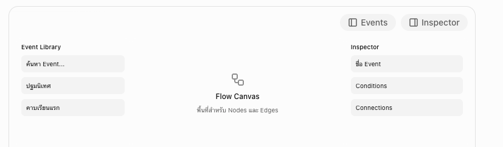

# 1. ปัญหาที่เห็นจากภาพ

| จุด            | ปัญหา                             | วิธีแก้                     |
| -------------- | --------------------------------- | --------------------------- |
| Canvas ตรงกลาง | พื้นที่เหลือประมาณ60%             | ขยายให้ใช้เต็มหน้าจอ        |
| Sidebar ซ้าย   | กินพื้นที่ตลอดแม้ไม่ได้ค้นหาEvent | ยุบ/ขยายได้                 |
| Toolbar        | ปุ่มเยอะและกระจาย                 | จัดกลุ่มตามหน้าที่          |
| MiniMap        | แสดงโครงสร้างแต่ใช้ค้นหาNodeยาก   | เพิ่ม Search และ JumptoNode |

# 2. ปรับ UX สำหรับการลากเส้นเชื่อม Event

สำหรับ Edge (เส้นเชื่อม) แนะนำ:

- ใช้เส้นแบบ Smooth Step เพื่อให้เส้นอ่านตามได้ง่าย
- แสดงชื่อ Choice หรือ Condition บนเส้น เช่น ตกลง, ปฏิเสธ, ผ่าน, ไม่ผ่าน
- คลิกเส้นแล้วเปิด Inspector เพื่อแก้ไขการเชื่อมต่อ
- Highlight เส้นทางต้นทางและปลายทางเมื่อเลือก Node
- ลดความเด่นของเส้นและ Node อื่นชั่วคราวเมื่อ Focus
- รองรับ Undo/Redo สำหรับการลากเส้น ลบ และเปลี่ยนตำแหน่ง

เพิ่มเติม เพิ่มสีของแต่ละ Event ตามแต่ละประเภท

# 3. การจัดการ Flow ขนาดใหญ่

จากภาพที่มี Node หลายสิบตัว ผมคิดว่าจุดนี้สำคัญมาก เพราะต่อให้ Canvas กว้าง 100% ก็ยังใช้งานลำบากได้ถ้าทุก Node แสดงพร้อมกัน แนะนำเพิ่ม Focus Mode โดยเมื่อคลิก Event ใด Event หนึ่ง จะเลือกดูเฉพาะเส้นทางที่เกี่ยวข้อง

นอกจากนี้ควรมี Fit Selection, Fit All, Go to Event และ Reset Layout แยกจากกันชัดเจน

# 4. การทำงานของ Sidebar ที่ควรเป็น

แนะนำให้ Inspector เปิดเป็น Drawer ที่ลอยเหนือ Canvas ได้ด้วย เพื่อให้แก้ Node โดยไม่ทำให้ตำแหน่งบน Canvas ขยับทุกครั้ง

# 5. ข้อสรุป (2026-10-29)

- สีการ์ดเหตุการณ์แยกตาม `kind` (`main`, `conditional`, `holiday`, `random`)
- Undo/Redo ครอบคลุมแค่การแก้ flow ไม่รวมการแก้เหตุการณ์ใน modal
- ชื่อ choice บนเส้นแสดงเฉพาะตอน hover, เลือก หรือ focus เพื่อไม่ให้รกตอนซูมออก
- Focus Mode เริ่มที่การ์ดที่เชื่อมตรง (1 hop) และจางส่วนอื่นโดยไม่ซ่อน
- แบ่งงานใน `docs/PROGRESS.md`: Step 34 (layout), Step 35 (focus + อ่านง่าย), Step 36 (undo/redo + แก้ไขอย่างปลอดภัย)
