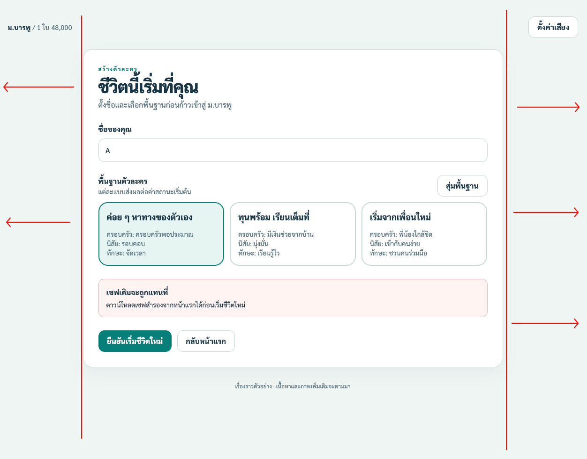
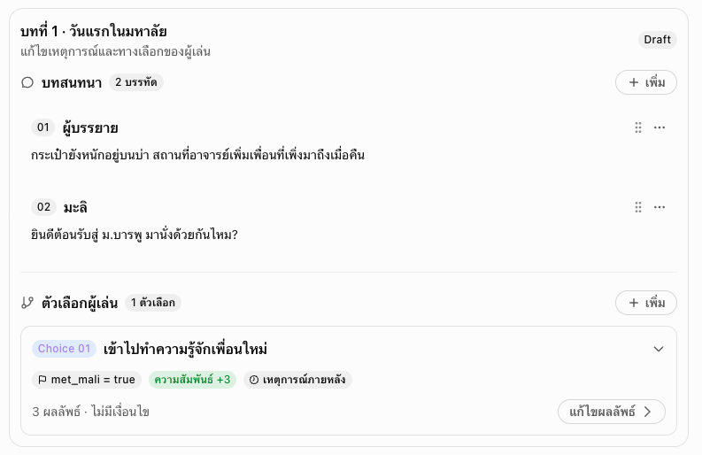

# New Requirement

## Game rules and data contract

- ออกแบบให้ Stat ติดลบได้
- เพิ่ม Stat หนี้ มีทั้งจาก กยศ., กรอ., ติดหนี้เพื่อน หรือการพนัน ให้เป็น Stat หนี้ค่าเดียว

## Game Play

- ชื่อของคุณ เปลี่ยนเป็นสุ่ม สร้างไฟล์มา และใส่ Default 3 ชื่อ ฟ้า, มายด์, อิม
- พื้นฐานตัวละคร แสดงค่า stat ด้วย
- พื้นฐานตัวละคร หากกดสุ่มจะไม่แสดงว่าเลือกอะไร
- `choice` แสดงเลยว่าเลือกอันนี้ Stat ไหนเพิ่มหรือลดม, แสดงเปอร์เซ็นโอกาศได้ผลดีหรือเสีย เช่นซื้อหวย โอกาสถูก 3% ถ้าถูกได้เงิน ไม่ถูกไม่เป็นไร, และทำรองรับ แสดงเปอร์เซ็น แล้วบอกว่าจะลด Stat อะไรโดยไม่บอกว่าลดเท่าไหร่
- เพิ่ม Timeline 4 ปีและรองรับ 6 ปี หรือ 8 ปีกรณีสอบไม่ผ่าน
- บทสรุปชีวิต เพิ่มแสดงการตัดสินใจ หรือเหตุการณ์เป็น Timeline

## UX/UI

- 
- ขนาย Content ให้ยาวเท่ากับขอบของ Logo
- ปุ่ม Action ไว้ข้างขวา
- ชื่อ Sence แสดงสองที่ทั้ง Title และในภาพ เอาในภาพออก
- เพิ่มธีม light/dark, light เป็นโทนขาว-เหลืองอ่อนๆ, Dark เป็นโทนเทามืด+ทองนิดๆ

## Others

- เสียงเล่นตลอดทุกหน้า Playable
- ตั้งค่าเสียง มีแค่เสียงเพลง แล้วทำเป็นปุ่มเปิดปิดพอไม่ได้ต้องมี option setting, default เสียงไว้ที่ 20%
- "เซฟเดิมจะถูกแทนที่" ไม่ต้องแจ้งเตือนเริ่มได้เลย

---

# BO

- เปลี่ยนจาก html เป็น Rout /content-manage
- เพิ่มค้นหาและ Filter เหตุการณ์
- Event ID, Choice ID เพิ่ม rule ต้องเป็น snack_case only (เช่น lost_student_card) และเพิ่มสุ่ม ID ให้
- เพิ่ม Tab จัดการ ผู้พูด, backgound, sound
- หน้า timeline เพิ่ม Filter ชนิดของ Event
- ทดลองเหตุการณ์ หากกดแล้วเปิดเป็น Modal แทน
- ตัดเสียงบรรยากาศออกไม่ได้ใช้
- หน้า Timeline ปี และช่วงเวลา หากมี main (เหตุการณ์หลัก) เกิน 10 ขึ้น Warning เตือน แต่ก็ยังเพิ่มได้
- ปรับ UI หน้า ฟอร์มแก้ไข
- ปรับ dropdown เป็น component กลางไม่ใช้ native
- UX/UI
- 
- การปรับแต่ละส่วน

| ส่วน           | ปรับUX/UI                                                  |
| -------------- | ---------------------------------------------------------- |
| บทสนทนา        | ใช้CompactCardแสดงผู้พูดและข้อความ                         |
| Speaker        | เลือกผู้พูดแล้วแสดงAvatar/ชื่ออัตโนมัติ                    |
| Portrait       | ซ่อนไว้ในAdvancedSettingsหากไม่ได้ใช้งาน                   |
| ChoiceID       | เก็บไว้ในAdvancedหรือแสดงเป็นข้อความรอง                    |
| เงื่อนไข       | ใช้ConditionBuilderแบบอ่านเป็นประโยค                       |
| ผลลัพธ์        | แสดงSummaryเป็นBadgeที่มีความหมาย                          |
| ผลลัพธ์ภายหลัง | ใช้NestedSectionที่ขยายหรือยุบได้                          |
| เพิ่ม/ลบ       | ปุ่มเพิ่มท้ายกลุ่มและเมนู`···` สำหรับลบ/ทำซ้ำ |

- เพิ่ม modal comfirmation
- ค่า True/False ใช้ checkbox
- สิ่งที่ควรเพิ่มสำหรับ Story Editor
  - Collapse / Expand — ยุบรายละเอียดตัวเลือกหรือผลลัพธ์ที่ไม่ได้แก้ไขอยู่
  - Drag & Drop — จัดลำดับบทสนทนาและตัวเลือก
  - Duplicate — คัดลอกบทสนทนาหรือตัวเลือกแล้วแก้ไขต่อ
  - Live Preview — แสดงบทสนทนาราวกับอยู่ในหน้าเกมจริง
  - Validation — แจ้งเตือน Flag ID, Event ID หรือข้อมูลที่ไม่สมบูรณ์
  - Sticky Toolbar — ปุ่ม Save, Undo, Redo และ Preview อยู่ในตำแหน่งที่หาเจอเสมอ
