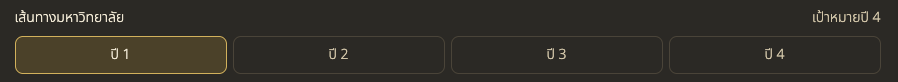

# New Requirement

## Game rules and data contract

- ออกแบบให้รองรับ Choice มากกว่า 2 และรองรับเลือกได้หลายตัวเลือก
- เมื่อเริ่มเกมจะต้องมีเหตุการณ์เริ่มต้นเสมอ Fix ไว้เลย เลือกว่าจะเรียนคณะอะไร สาขาอะไร
- ปี 3 จะต้องเลือกวิชาเสรี
- สร้างไฟล์รองรับการเพิ่ม ทั้งคณะ, สาขา และวิชาเสรี
- บางคณะ บางสาขามีผลว่าต้องเรียน 6 ปี
- จะเรียน 6 ปีได้จะต้องเพิ่มเรื่องเป็นคณะและสาขาที่รองรับ
- ไม่ต้องทำ V1 V2 ยังไม่ได้ Release

## Game Play

- เอาเล่นต่อและดาวโหลด Save ออก เพราะกดเล่นต่อไปก็ทำอะไรไม่ได้ ต้องเริ่มใหม่อยู่ดี จะไม่มีโหลด Save แล้ว
- Future ในอนาคต Share result ได้ (ยังไม่ทำ)
- เอาสุ่มชื่อออก เป้าหมายต้องการให้เป็นการสุ่ม เลือกไม่ได้
- ไม่ต้องแสดง "ผลลัพธ์ภายหลัง"

## UX/UI

- 
- ย้าย choice ไปไว้ใต้สถานะ และ lock บทสนทนา ไว้เหมือนเดิม
- UI จะขยับแค่ choice ตรงอื่นอยากให้คงที่ไว้ตลอด เป้าหมายจะไม่ต้องเลื่อนเมาส์เยอะ
- ทำรองรับ Choice มากกว่า 2 และรองรับเลือกได้หลายตัวเลือก
- 
- ปรับ UI Timeline อันนี้ดูเหมือน Button มากไป
- 
- ตัวอย่าง UI Timeline

## Others

# BO

- เพิ่ม Tab การจัดการชื่อของผู้เล่น จัดการชื่อและเชื่อมรูปภาพ
- หน้าเหตุการณ์ เอา drag event ออกเหลือไว้แค่ปุ่มขึ้นลง
