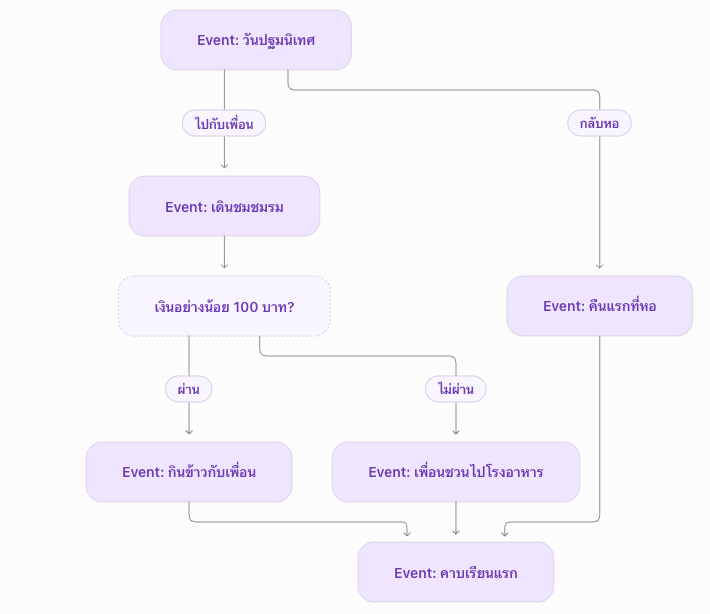
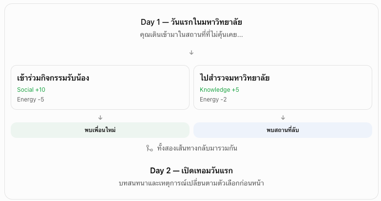
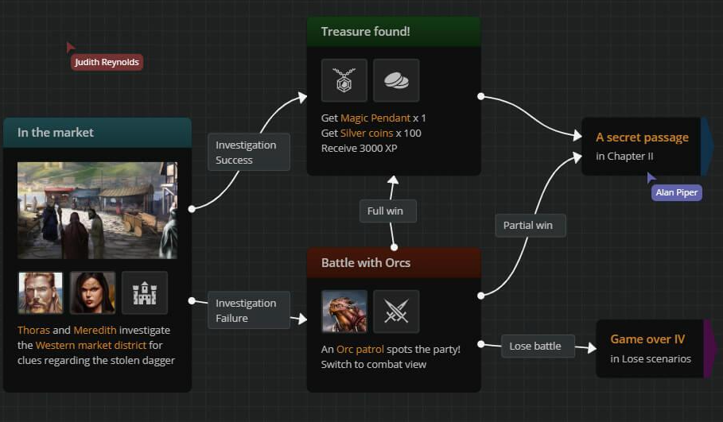

# **Story Flow Edito**

ใช้การ์ด Event ลากเส้นเชื่อมกัน และเพิ่ม Condition หรือ Random เฉพาะจุดที่ต้องใช้

**ตัวอย่าง Flow**

**รูปแบบหน้าจอ**

- **ซ้าย:** คลัง Event พร้อมค้นหาและกรองตามปี/เทอม ลากลงกระดานได้
- **กลาง:** กระดาน Flow สำหรับจัดการ์ด ลากเส้น ซูม และดูเส้นทางเรื่อง
- **ขวา:** ฟอร์มรายละเอียดของการ์ดหรือเส้นที่เลือก
- **ด้านบน:** Undo/Redo, จัดตำแหน่งอัตโนมัติ, ตรวจความถูกต้อง, Preview และบันทึก

**การ์ดที่ใช้**

| การ์ด           | หน้าที่                                                  |
| --------------- | -------------------------------------------------------- |
| **Start**       | จุดเริ่มต้นของเรื่อง                                     |
| **Event**       | บทสนทนา ภาพ เสียง ตัวเลือก และผลต่อสถานะ                 |
| **Condition**   | ตรวจสถานะหรือ Flag แล้วแยกทาง ผ่าน/ไม่ผ่าน รองรับ AND/OR |
| **Random**      | สุ่มจาก Event ที่เชื่อมไว้และผ่านเงื่อนไข พร้อมทางสำรอง  |
| **Next Period** | จบช่วงปัจจุบันและเลื่อนไปช่วงเวลาถัดไป                   |
| **Ending**      | เข้าตอนจบ                                                |

**วิธีเชื่อมเส้นทาง**

- แต่ละตัวเลือกบน Event มีจุดให้ลากเส้นของตัวเอง
- เชื่อมไป Event ถัดไปได้โดยตรง
- เงื่อนไขง่ายใส่บนเส้นได้ ส่วนหลายเงื่อนไขใช้ Condition Node
- หลายเส้นทางกลับมารวมที่ Event เดียวกันได้
- บนการ์ดแสดงชื่อ ภาพย่อ ข้อความสั้น และตัวเลือก ส่วนรายละเอียดแก้ในแผงขวา

**กติกาฝั่งเกม**

1. ผู้เล่นเลือกคำตอบ → ใช้ผลต่อสถานะและ Flag → เดินตามเส้นที่เชื่อมไว้
2. ถึง Condition → ตรวจข้อมูลล่าสุดแล้วเลือกเส้นทาง
3. ถึง Random → สุ่มจากปลายทางที่มีสิทธิ์ โดยใช้ seed ของเกมและบันทึกผลเพื่อให้โหลดต่อได้เหมือนเดิม
4. ถึง Next Period → เลื่อนช่วงเวลา
5. ถึง Ending → แสดงตอนจบ

จึงต้องปรับ **ระบบเดินเรื่องให้ใช้เส้นเชื่อมจริง** แทนการเลือก Event ตามประเภทและช่วงเวลาแบบปัจจุบัน

**การตรวจและทดลองเล่น**

- แจ้งเส้นขาด ปลายทางหาย และตัวเลือกที่ยังไม่เชื่อม
- แจ้ง Condition ที่ไม่มีทางออกหรือ Random ที่ไม่มีทางสำรอง
- เตือน Event ที่เดินไปไม่ถึงและวงวนที่อาจออกไม่ได้
- Preview ไฮไลต์เส้นทางจริง พร้อมสถานะและเหตุผลที่ผ่าน/ไม่ผ่านเงื่อนไข

**ข้อมูลยังใช้ JSON และเก็บ local ตามเดิม** โดยเพิ่มข้อมูล Node, เส้นเชื่อม และตำแหน่งการ์ดสำหรับ BO ส่วนการแบ่งกระดานตามปี/เทอมยังเป็นข้อเสนอที่เลือกกำหนดภายหลังได้ครับ

## Random Seed

**เส้นที่เชื่อมตรงจะล็อกลำดับ แต่ Flow ยังมีการสุ่มด้วย seed ได้** ขึ้นอยู่กับชนิดของจุดที่เดินผ่านครับ

| รูปแบบ        | วิธีเลือก Event ถัดไป                              |
| ------------- | -------------------------------------------------- |
| **เชื่อมตรง** | ไป Event ที่กำหนดแน่นอน                            |
| **Condition** | เลือกตามสถานะหรือ Flag ของผู้เล่น                  |
| **Random**    | ใช้ seed สุ่มจาก Event ที่เชื่อมไว้และผ่านเงื่อนไข |

ตัวอย่าง: **จบคาบเรียน → สุ่มเหตุการณ์ระหว่างวัน → กลับหอ**
ตรงกลางอาจสุ่มเจอเพื่อน เจอฝน หรือได้รับงานพิเศษ แต่สุดท้ายกลับมาเข้าเส้นเรื่องหลักได้

**Seed ไม่ได้กำหนดว่าเรื่องต้องอิสระหรือเป็นเส้นตรง** แต่ช่วยให้การสุ่มทำซ้ำได้ เมื่อ seed สถานะตัวสุ่ม รายการ Event และการตัดสินใจเหมือนเดิม ผลสุ่มก็เหมือนเดิมครับ

แนะนำให้ใช้ **Flow คุมเหตุการณ์หลัก + Random Pool สำหรับเหตุการณ์ระหว่างทาง** โดย Random Node เลือกกลุ่ม เช่น “ชีวิตปี 1 เทอม 1” แล้วระบบหา Event ที่ผ่านเงื่อนไขมาสุ่มเอง **ไม่ต้องลากเส้นไปหา Event สุ่มทุกอัน** แบบนี้ยังได้ความหลากหลาย
