# Play UX/UI

- หาบัคก่อน
  - เจออันนึงหน้า Play : บันทึกตัวเลือกไม่ได้ โปรดลองอีกครั้ง
  - 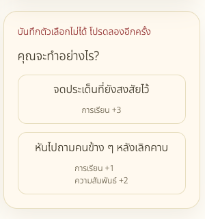 check ให้หน่อย
- เช็ค responsive for webview
- ทำ component UI แยกจาก BO
- ปรับ dropdown เป็น component กลาง ไม่ใช้ Native
- นำ Graphic Status จาก public/assets/status มาใช้
- เช็คเรื่องปุ่มหรือสี ว่าเข้ากันไหม
  - 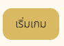 ควร font white เหมือนปุ่มไหม ถ้า backgound มืด

## 1. Home

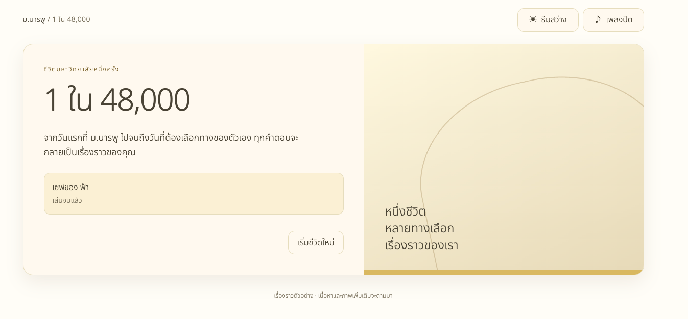

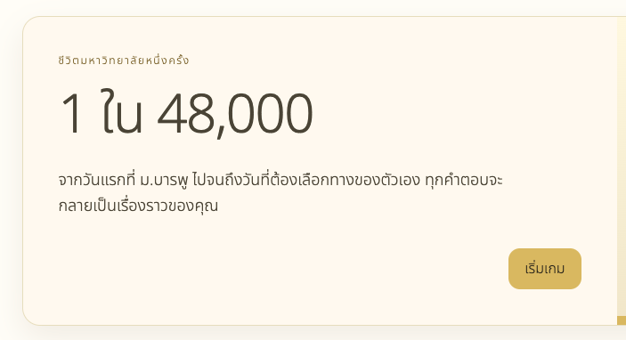

- เอา "เซฟของ ... " ออก จะเหลือเพียง "เริ่มเกม"
- กรอบทองข้างซ้าย เอา public/assets/pixel_campus_friends-in-bloom.png มาใส่

## 2. หน้าเลือกชีวิตเริ่มต้น

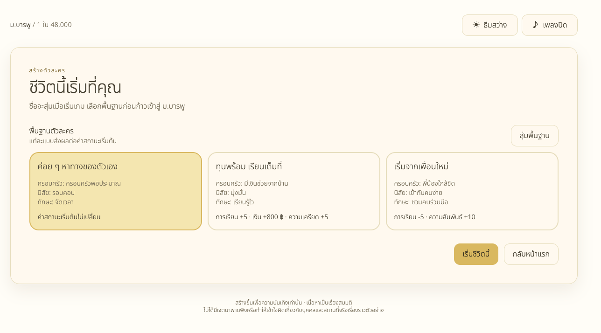

- แสดงชื่อที่สุ่มไว้และ portrait มาแสดงเลย
- นำ Graphic Status จาก public/assets/status มาใช้ เช่น [study.png] การเรียน +4
- 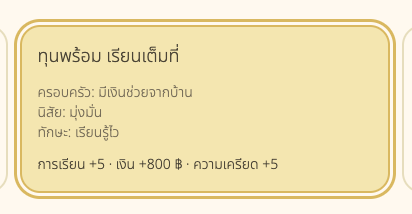 ตอนกดเลือกมันมีขอบมา เอาขอบออกให้หน่อย

## 3. หน้าเกม: หน้าเลือกคณะและสาขา

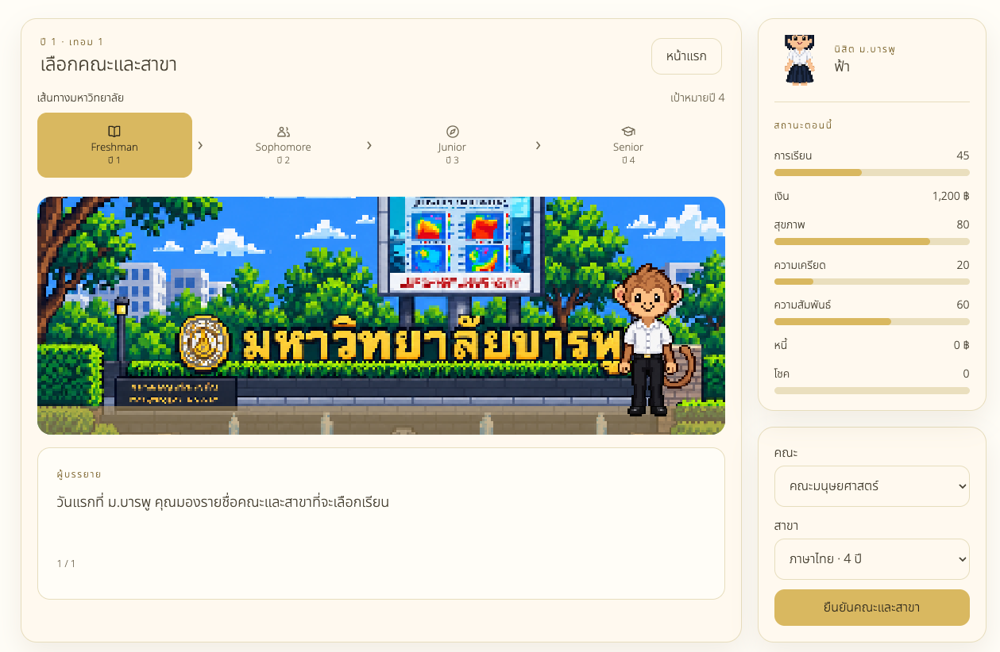

- 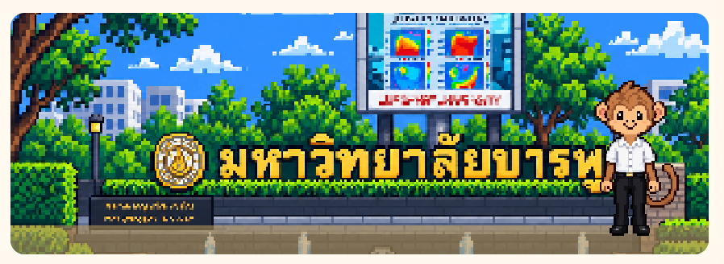 ส่วนรูปที่แสดง ภาพ scene มีขนาด 320 × 180 ปรับให้เหมาะสมหน่อย
- 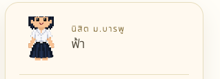ส่วนของ Player
  - ปรับรูปโปรไฟล์ในเต็ฒตัว
- 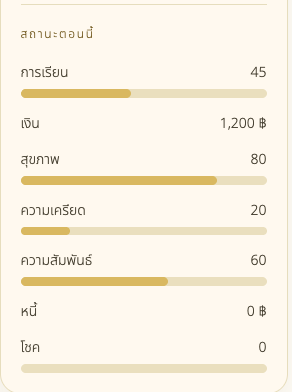
  - เอา Graphic Status จาก public/assets/status มาใช้ เช่น [study.png] การเรียน
  - เอา เงินและหนี้ มาไว้ข้างล่างสุด เอาที่มีหลอดไปไว้ด้วยกัน
- 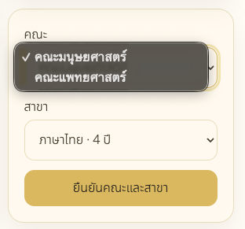ปรับ dropdown เป็น component กลาง ไม่ใช้ Native
- 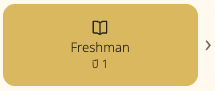ควร font white เหมือนปุ่มไหม ถ้า backgound มืด

## 4. หน้าเกม: หน้าเล่นเกม

- ส่วนของ ปุ่ม, dropdown, รูป scene, profile, status ปรับเหมือนก่อนหน้า
- 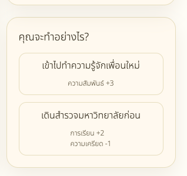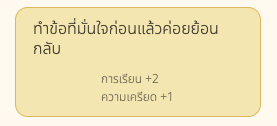ส่วนของตัวเลือก
  - เช็ค UI หน่อย layout ตัวเลือกและstatus เหมือนไม่ตรงกัน
    - ตัวเลือก ชิดซ้าย
    - status ชิดซ้าย
  - เอา Graphic Status จาก public/assets/status มาใช้ เช่น [study.png] การเรียน +2
- 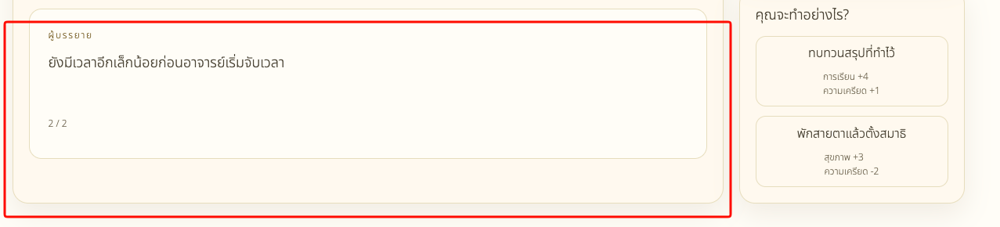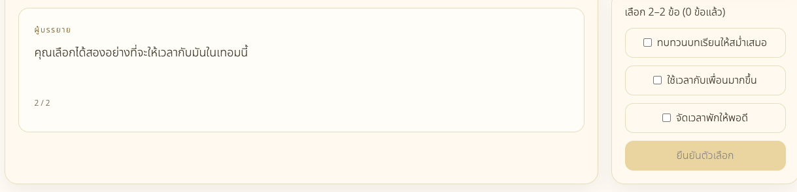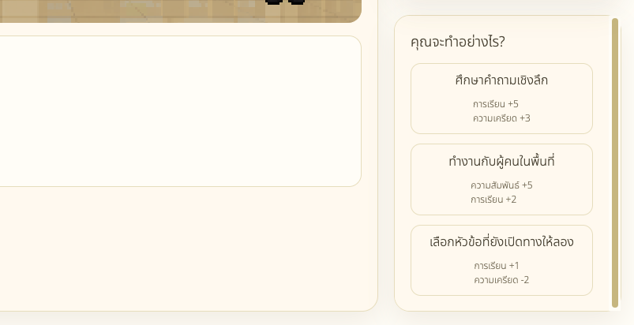
  - ถ้า choice ยาว ด้านซ้ายไม่ต้องยาวตามได้ไหม
- 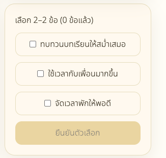
  - check box ทำ UI ให้เขากับระบบ และชิดซ้าย
  - แสดง status ด้วย ถ้าเลือกอะไรแล้ว +/- สถานะอะไร
- 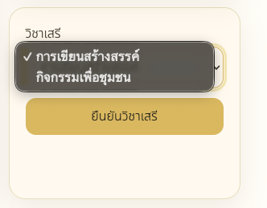
  - ปรับ dropdown เป็น component กลาง ไม่ใช้ Native
  - เอาปุ่มยืนยันไม่ข้างล่าง
- 
  - เอา scroll bar ของตัวเลือกออก แต่ยัง scroll ได้

## 5. บทสรุปชีวิต

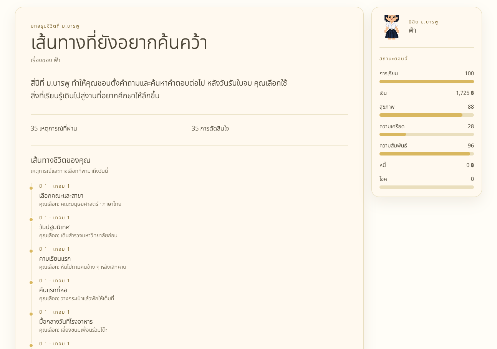

- แยก เส้นทางชีวิตของคุณ ออกมาอีกการ์ดด้านล่าง
- เอาปุ่ม เริ่มใหม่ ไว้การ์ดแรก
- เอาปุ่มหน้าแรกออก
- การ์ด เส้นทางชีวิตของคุณ
  - ย่อขยายได้
  - แยกตามปี
  - ปรับเส้น timeline ให้ดูง่ายๆ
